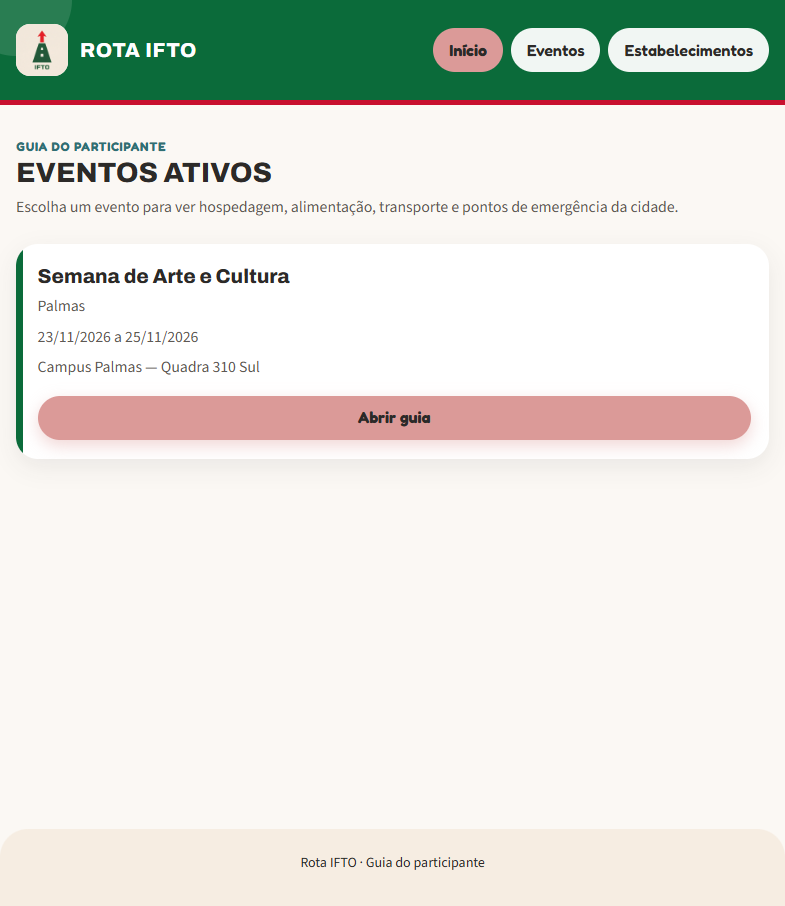
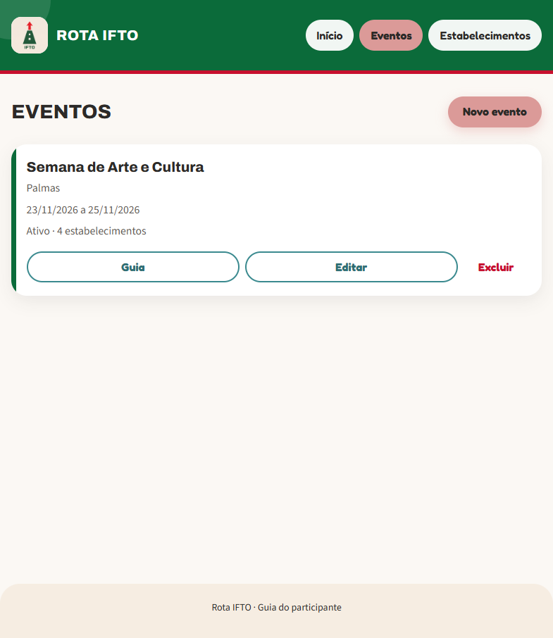
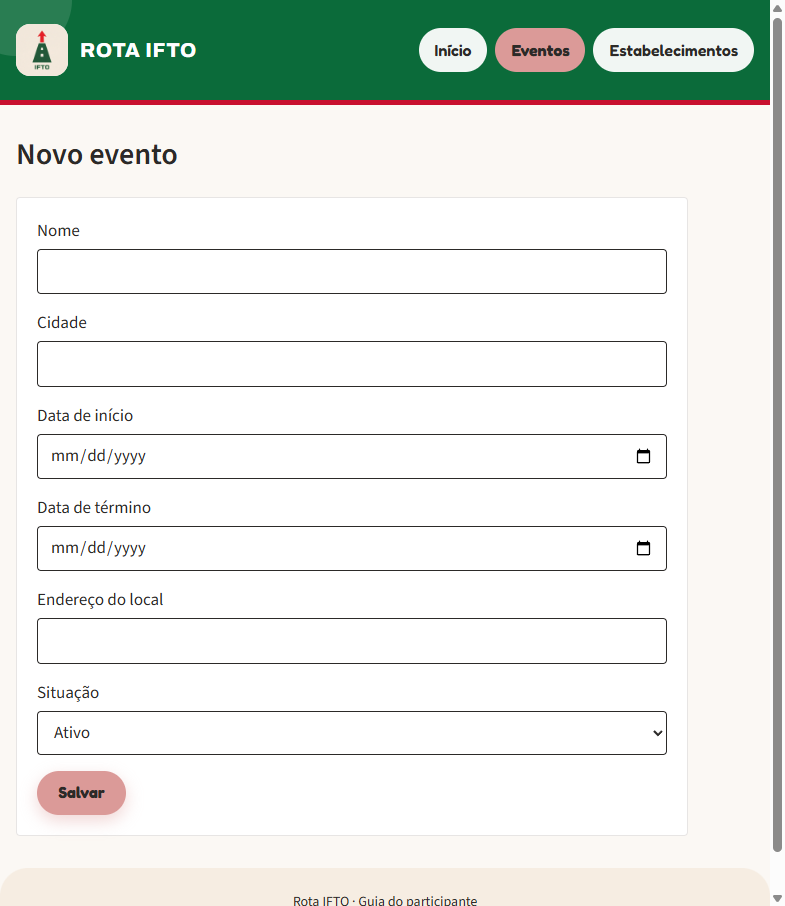
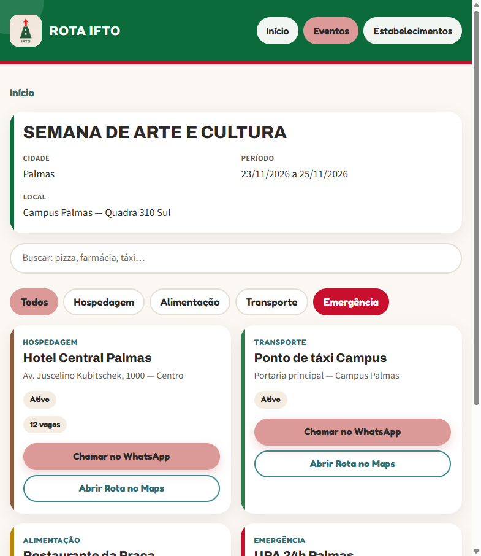
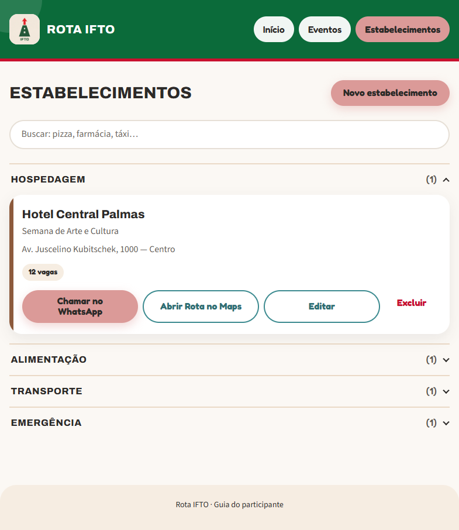
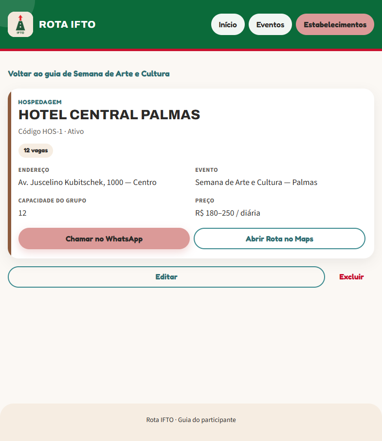

# Rota IFTO

Guia do participante para eventos do IFTO: centraliza hospedagem, alimentação, transporte e pontos de emergência da cidade em um só lugar.

[](https://www.php.net/)
[](https://laravel.com)
[](https://tailwindcss.com)
[](https://vitejs.dev)
[](https://opensource.org/licenses/MIT)
[](https://github.com/terrariaViniboy/ROTA_ifto)

## Índice

- [Sobre o projeto](#sobre-o-projeto)
- [Funcionalidades](#funcionalidades)
- [Demonstração](#demonstração)
- [Tecnologias utilizadas](#tecnologias-utilizadas)
- [Estrutura de pastas](#estrutura-de-pastas)
- [Como rodar o projeto](#como-rodar-o-projeto)
- [Como usar](#como-usar)
- [Roadmap](#roadmap)
- [Como contribuir](#como-contribuir)
- [Licença](#licença)
- [Autores](#autores)

## Sobre o projeto

Em eventos do Instituto Federal do Tocantins (IFTO), participantes e equipes precisam achar rápido onde dormir, comer, se locomover e buscar ajuda na cidade. Hoje essa informação costuma ficar espalhada em mensagens, planilhas e links soltos.

O **Rota IFTO** concentra esses dados por evento: a pessoa abre o guia, filtra por categoria e chega ao WhatsApp ou ao mapa do lugar. Quem organiza cadastra eventos e estabelecimentos pelo próprio site.

Repositório: [https://github.com/terrariaViniboy/ROTA_ifto](https://github.com/terrariaViniboy/ROTA_ifto)

## Funcionalidades

O que já existe no código hoje:

- **Início** — lista apenas os eventos marcados como ativos
- **Eventos** — cadastrar, listar, ver, editar e excluir (nome, cidade, período, endereço e situação)
- **Guia do evento** — lugares ligados ao evento, com filtro por categoria (`hospedagem`, `alimentacao`, `transporte`, `emergencia`)
- **Estabelecimentos** — cadastrar, listar, ver, editar e excluir, com código único, situação (ativo, lotado ou inativo), capacidade, faixa de preço, WhatsApp e link do Maps
- **Atalhos** — abrir WhatsApp (`wa.me`) e rota no Google Maps (link informado ou busca pelo endereço)
- **Testes automatizados** — CRUD e validação de eventos e estabelecimentos, além do guia público

> O campo de busca nas telas do guia e da lista de estabelecimentos é só visual: ainda **não filtra** resultados.

## Demonstração

| Tela | Preview |
| --- | --- |
| Início (eventos ativos) |  |
| Lista de eventos |  |
| Formulário de evento |  |
| Guia do participante |  |
| Lista de estabelecimentos |  |
| Ficha do estabelecimento |  |

## Tecnologias utilizadas

| Tecnologia | Uso no projeto | Versão de referência |
| --- | --- | --- |
| PHP | Runtime | `^8.2` (`composer.json`) |
| Laravel | Framework e rotas web | 12.72.0 (`composer.lock`) |
| Blade | Templates das telas | incluso no Laravel |
| Tailwind CSS | Utilitários de estilo | 4.3.5 (`package-lock.json`) |
| Vite | Build do front-end | 7.3.8 (`package-lock.json`) |
| PostgreSQL ou SQLite | Banco de dados | conforme `.env` |
| PHPUnit | Testes | 11.5.58 (`composer.lock`) |
| Axios | Cliente HTTP no front (carregado via `resources/js`) | 1.21.1 (`package-lock.json`) |

Node.js: o Vite 7 exige `^20.19.0` ou `>=22.12.0` (conforme `engines` do pacote Vite instalado).

## Estrutura de pastas

```text
ROTA_ifto/
├── app/
│   ├── Http/Controllers/   # Início, eventos e estabelecimentos
│   └── Models/             # Event, Establishment e User
├── database/
│   ├── migrations/         # Tabelas do app e do Laravel
│   └── seeders/            # Seeder padrão (usuário de teste)
├── public/                 # Entrada HTTP e assets públicos
├── resources/
│   ├── css/                # Estilos (Tailwind + CSS do guia)
│   ├── js/                 # Entrada Vite / Axios
│   └── views/              # Telas Blade
├── routes/web.php          # Rotas do site
└── tests/Feature/          # Testes do guia e dos cadastros
```

## Como rodar o projeto

### Pré-requisitos

- PHP 8.2 ou superior, com extensões comuns do Laravel (entre elas `pdo`, `mbstring`, `openssl`, `tokenizer`, `xml`, `ctype`, `json`, `fileinfo` e, se for SQLite, `pdo_sqlite` / `sqlite3`)
- Composer
- Node.js compatível com Vite 7 (`^20.19.0` ou `>=22.12.0`) e npm
- Banco: **PostgreSQL** (padrão do `.env.example`) **ou** **SQLite**

### 1. Clonar e instalar

```bash
git clone https://github.com/terrariaViniboy/ROTA_ifto.git
cd ROTA_ifto
composer install
npm install
```

### 2. Ambiente

```bash
cp .env.example .env
php artisan key:generate
```

No Windows (PowerShell), se `cp` não existir:

```powershell
Copy-Item .env.example .env
php artisan key:generate
```

### 3. Configurar o banco

Escolha **um** dos caminhos abaixo. Sessão, cache e fila usam o banco (`SESSION_DRIVER`, `CACHE_STORE` e `QUEUE_CONNECTION` = `database` no `.env.example`), então as migrations precisam rodar antes de usar o site.

<details>
<summary>Opção A — PostgreSQL (padrão do <code>.env.example</code>)</summary>

No `.env`, mantenha (ou ajuste) algo nesta linha:

```env
DB_CONNECTION=pgsql
DB_HOST=127.0.0.1
DB_PORT=5432
DB_DATABASE=rota_ifto
DB_USERNAME=postgres
DB_PASSWORD=
```

Crie o banco `rota_ifto` no PostgreSQL e, se precisar, preencha usuário e senha. Depois:

```bash
php artisan migrate
```

</details>

<details>
<summary>Opção B — SQLite</summary>

1. Crie o arquivo do banco:

```bash
touch database/database.sqlite
```

No Windows (PowerShell):

```powershell
New-Item -ItemType File -Force database/database.sqlite
```

2. No `.env`, use SQLite e comente (ou remova) as linhas `DB_HOST`, `DB_PORT`, `DB_DATABASE`, `DB_USERNAME` e `DB_PASSWORD` do PostgreSQL. Exemplo mínimo:

```env
DB_CONNECTION=sqlite
# DB_HOST=127.0.0.1
# DB_PORT=5432
# DB_DATABASE=rota_ifto
# DB_USERNAME=postgres
# DB_PASSWORD=
```

3. Rode as migrations:

```bash
php artisan migrate
```

</details>

### 4. Assets e servidor

**Desenvolvimento (dois terminais — recomendado no Windows)**

O script `composer run dev` sobe servidor, fila, Pail e Vite juntos. Em alguns ambientes Windows o Pail exige a extensão `pcntl` e o comando pode encerrar tudo. Nesse caso, use:

```bash
php artisan serve
```

```bash
npm run dev
```

Abra `http://127.0.0.1:8000` (ou a URL que o `artisan serve` mostrar).

**Atalho (Linux/macOS ou ambiente com `pcntl`)**

```bash
composer run dev
```

**Build de assets (produção / sem Vite em modo watch)**

```bash
npm run build
php artisan serve
```

### 5. Testes (opcional)

```bash
composer test
```

Os testes usam SQLite em memória (`phpunit.xml`).

### Observações

- `composer run setup` instala dependências, copia `.env` se faltar, gera a chave, roda `migrate --force`, instala o npm e faz `npm run build`. Ainda assim é preciso configurar o banco no `.env` **antes** do migrate, se não for o padrão esperado na sua máquina.
- O seeder padrão (`php artisan db:seed`) cria apenas um usuário de teste. **Não** popula eventos nem estabelecimentos. Não há tela de login neste protótipo.
- Não versionamos `.env` nem arquivos `*.sqlite*`.

## Como usar

1. Em **Eventos**, cadastre um evento e marque-o como ativo.
2. Em **Estabelecimentos**, vincule lugares ao evento (categoria, código, endereço, situação; WhatsApp e Maps são opcionais).
3. No **Início**, abra o guia do evento ativo — ou use o link **Guia** na lista de eventos.
4. No guia, filtre por categoria e use **Chamar no WhatsApp** ou **Abrir Rota no Maps** quando os dados estiverem preenchidos.

## Roadmap

Ideias para as próximas versões (ainda não implementadas):

- [ ] Página **ADM** para cadastrar e gerenciar eventos e estabelecimentos
- [ ] Busca real nos campos de pesquisa do guia e da lista de estabelecimentos
- [ ] Melhorias de formulários e acessibilidade nas telas de cadastro
- [ ] Dados de demonstração (seed) opcionais para quem for testar o guia

## Como contribuir

1. Faça um fork do repositório
2. Crie uma branch (`git checkout -b minha-melhoria`)
3. Commit com mensagem clara
4. Abra um pull request descrevendo o que mudou

Antes de enviar, rode `composer test` se a mudança afetar regras de negócio ou rotas.

## Licença

Este projeto está sob a licença [MIT](LICENSE).

## Autores

- Gustavo Romão Elástico
- Jean Carlo Torres de Oliveira
- João Emanuel Câmara Castro
- Vinicio Moreira Carvalho
